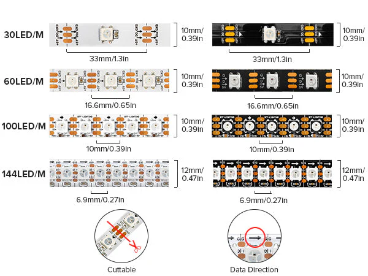
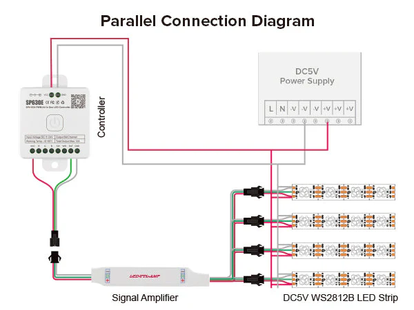
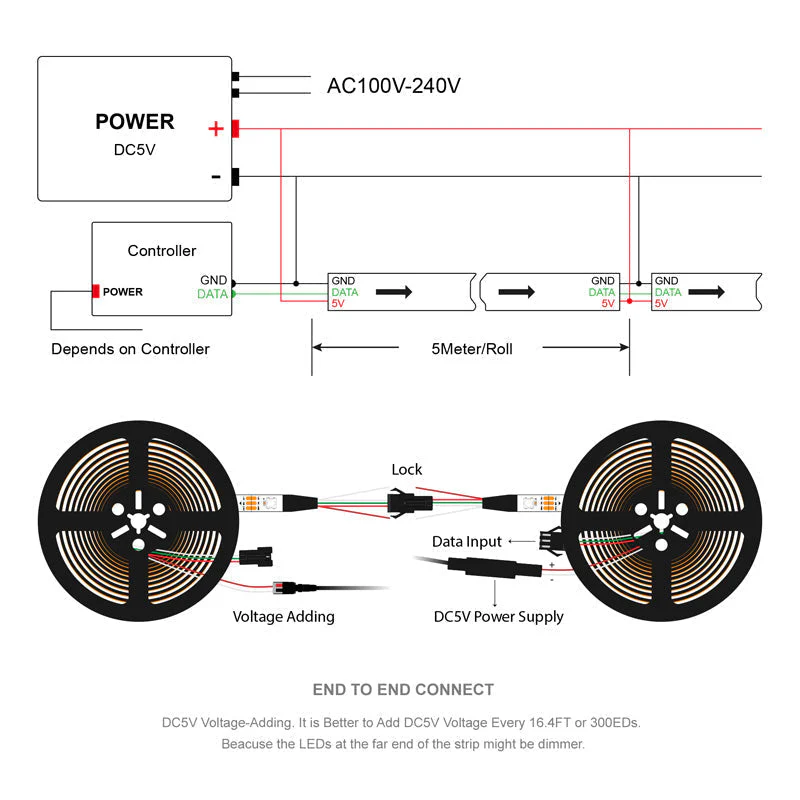

# RGB Lighting

Everything to know about Smart RGb lighting

Author

Benedict Thekkel

RGB smart LED strips, like the WS2818B and other models, are popular for customizable lighting projects. They offer flexibility, addressable LEDs, and dynamic lighting effects. Here’s what you should know about the types, features, and considerations when choosing RGB smart LED strips:

### 1. **Types of RGB Smart LED Strips**

There are various types of RGB LED strips, often distinguished by the type of LED, chipset, and control methods:

- **WS2812B/WS2813**:
  - Each LED is individually addressable, meaning each LED can be controlled independently for color and brightness.
  - WS2813 is a newer version, which has backup data lines for redundancy; if one LED fails, the rest will still work.
  - 1 data line, which simplifies wiring.
- **WS2818B**:
  - Dual-signal redundancy: If one LED fails, others in the series will continue functioning.
  - Addressable RGB LEDs with two data lines (Data and Backup Data).
  - Supports longer continuous runs compared to single-line strips like WS2812B due to improved data integrity.
  - Ideal for large, complex installations or places where reliability is essential.
- **SK6812**:
  - Similar to WS2812B but with better color accuracy.
  - Can support RGBW (RGB + white), adding a true white LED for more precise lighting effects.
  - Compatible with WS2812B controllers.
- **APA102 (DotStar)**:
  - Uses a separate clock and data line, enabling faster updates and smoother animations.
  - Better suited for high refresh-rate applications or when a faster response is needed.

### 2. **Voltage**

- **5V**: Common in WS2812B and WS2813 strips. Requires a power supply with good regulation, as voltage drop can be an issue over long distances.
- **12V**: Common in WS2818B strips. Offers less voltage drop, making it better for longer runs without needing power injection.
- **24V**: Available in some variants. Ideal for very long strips with less voltage loss, meaning fewer power injections are required.

### 3. **Addressable vs Non-addressable Strips**

- **Addressable (e.g., WS2818B, WS2812B)**: Each LED can be controlled independently, allowing for more complex effects like color waves, animations, and patterns.
- **Non-addressable (RGB)**: All LEDs show the same color and brightness at any given time.

### 4. **Number of LEDs per Meter**

LED strips are typically available in densities like **30 LEDs/m**, **60 LEDs/m**, **144 LEDs/m**. Higher densities (more LEDs per meter): - Offer brighter and smoother lighting effects. - Are better for complex animations. - Consume more power.

### 5. **Power Consumption**

- Power consumption depends on the number of LEDs and the type of strip. For instance:
  - WS2812B strips typically consume around **18W per meter** at full brightness for 60 LEDs/m.
  - WS2818B with 60 LEDs/m might consume a similar amount, but the 12V version reduces the effects of voltage drop over longer strips.
- Ensure your power supply provides adequate power for the entire strip, and consider injecting power at multiple points for longer strips to prevent brightness dimming.

### 6. **Control Methods**

- **Controllers**: Addressable LED strips need a controller that can send the appropriate signals. Popular options include:
  - **Arduino/ESP32/Raspberry Pi**: For DIY projects.
  - **Dedicated Controllers**: Like the SP108E or SP110E, designed specifically for addressable LED strips.
- **Communication Protocols**:
  - **Wi-Fi/Bluetooth**: Many smart LED strips come with Wi-Fi or Bluetooth control, allowing you to adjust lighting through apps.
  - **DMX**: Used in professional lighting setups, enabling synchronized control across multiple strips.

### 7. **Compatibility with Software**

Addressable LED strips, like WS2818B and WS2812B, are compatible with various software and libraries, such as: - **FastLED/Adafruit NeoPixel**: Arduino libraries for controlling addressable RGB strips. - **WLED**: A highly popular, customizable firmware for controlling addressable LED strips with a web interface, mobile apps, and voice assistants like Alexa.

### 8. **Waterproofing**

- **IP20**: No waterproofing, suitable for indoor, dry environments.
- **IP65**: Silicone coating, protects against dust and light splashes, good for indoor use in damp environments.
- **IP67/IP68**: Fully waterproof, can be submerged in water, ideal for outdoor applications.

### 9. **Durability and Longevity**

- Ensure the strip you choose has good heat dissipation. Addressable LEDs like WS2818B can generate heat, especially at higher brightness levels, which might reduce their lifespan.
- Aluminum profiles or channels can be used to house the LED strips for better cooling and aesthetic purposes.

### 10. **Use Cases**

- **Home decoration**: Accent lighting, TV backlighting, and ambiance lighting.
- **Commercial installations**: Advertising displays, bar lighting, and retail ambiance.
- **Creative projects**: Custom lighting setups, cosplay, and art installations.
- **Outdoor lighting**: Gardens, pathways, or building outlines (with waterproof strips).
- **Advanced projects**: Synchronize lighting with music, game setups, or AI-controlled smart home lighting.

### Things to Keep in Mind:

- **Power Supply**: Ensure the power supply matches the voltage and provides enough current for your strip.
- **Heat Management**: Addressable strips can get hot, so consider using aluminum channels for heat dissipation.
- **Distance Limitation**: For longer runs, you might need to inject power at multiple points to avoid voltage drop, especially with 5V strips.
- **Data Line Length**: Data signal integrity can degrade over long distances. For strips like WS2818B with dual-signal redundancy, this is less of an issue.

Understanding these factors will help you choose the right RGB smart LED strip for your project, ensuring you get the desired effects, performance, and longevity.

## The ones i have

## Power Supply (MODEL:s-100-5)

- AC input: 110/220V 50/60Hz
- DC output: 5V 20A

### 🔌 **Port Labels and Their Meanings (From Left to Right)**

From your first image:

| Terminal Label | Meaning | Use |
|----|----|----|
| `L` | **Live (AC input)** | Connect to the **Live wire** of AC mains (usually brown/red) |
| `N` | **Neutral (AC input)** | Connect to the **Neutral wire** of AC mains (usually blue/black) |
| ⏚ (Ground) | **Earth Ground** | Connect to **Earth** (green/yellow) for safety |
| `-V` | **Negative DC Output** | DC Ground (GND) — connect to the ground side of your device |
| `-V` | **Negative DC Output** | Same as above — dual terminals for high current distribution |
| `+V` | **Positive DC Output** | +5V — connect to the positive side of your device |
| `+V` | **Positive DC Output** | Same as above — dual terminals for current sharing |
| `ADJ` | **Voltage Adjust (Trim Pot)** | Small screw to fine-tune output voltage (~±10%) |

------------------------------------------------------------------------

### ⚠️ **Wiring Example (Standard AC to DC Usage)**

#### AC Input (left side):

- `L` → Connect to **Live** (mains AC)
- `N` → Connect to **Neutral**
- Ground ⏚ → Connect to **Earth Ground**

#### DC Output (right side):

- `+V` → Goes to **+5V line of your device**
- `-V` → Goes to **GND line of your device**

Use both `+V` and `-V` terminals if you’re drawing high current (e.g., 10A+), to spread the load.

------------------------------------------------------------------------

### 🔧 Notes

- Always power off and double-check connections before turning on.
- Ensure the **input voltage switch** (if present) matches your region (110V or 220V).
- The small orange potentiometer marked `ADJ` allows fine-tuning (e.g., 5.1V or 4.9V).

Back to top
