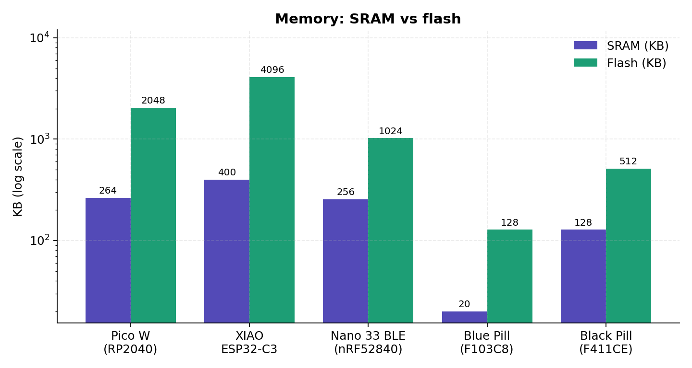
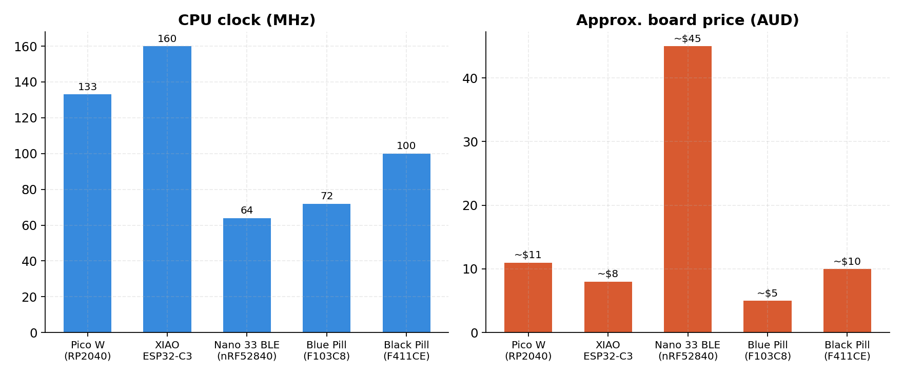

# Microcontroller dev board comparison

**Raspberry Pi Pico W · Seeed XIAO ESP32-C3 · Arduino Nano 33 BLE · STM32F (Blue Pill / Black Pill)**

Author

Benedict Thekkel

## 1. Spec comparison

| \- | Pico W | XIAO ESP32-C3 | Nano 33 BLE | Blue Pill F103 | Black Pill F411 |
|----|----|----|----|----|----|
| **MCU** | RP2040 + CYW43439 | ESP32-C3 | nRF52840 | STM32F103C8T6 | STM32F411CEU6 |
| **Core** | 2× Cortex-M0+ | 1× RISC-V RV32IMC | 1× Cortex-M4F | 1× Cortex-M3 | 1× Cortex-M4F |
| **Clock** | 133 MHz (OCs to 250+) | 160 MHz | 64 MHz | 72 MHz | 100 MHz |
| **FPU / DSP** | No / No | No / No | Yes / Yes | No / No | Yes / Yes |
| **SRAM** | 264 KB | 400 KB (~320 usable) | 256 KB | 20 KB | 128 KB |
| **Flash** | 2 MB external QSPI | 4 MB external | 1 MB internal | 64–128 KB internal | 512 KB internal |
| **Radio** | Wi-Fi 4 + BT 5.2 (CYW43439 over SPI) | Wi-Fi 4 + BLE 5.0 (native) | BLE 5 + 802.15.4 + NFC-A | None | None |
| **GPIO** | 26 | 11 | 22 (14 digital + 8 analog) | ~32 | ~30 |
| **ADC** | 3ch 12-bit (noisy, ~8.7 ENOB) | 12-bit (ADC2 unusable while Wi-Fi active) | 8ch 12-bit | 2× 12-bit @ 1 Msps | 12-bit @ 2.4 Msps |
| **USB** | 1.1 device *and* host | USB-Serial/JTAG (CDC only) | Native FS device | FS device (quirky pull-up on clones) | OTG FS + ROM DFU bootloader |
| **Debug** | SWD (needs Debug Probe / picoprobe) | JTAG over USB built in | SWD pads, external probe required | SWD via ST-Link clone | SWD via ST-Link |
| **Deep sleep** | Poor (~1 mA board-level) | ~44 µA — excellent | µA-class possible, not under stock Arduino/Mbed core | µA standby (silicon); board LEDs/regulator leak | Similar |
| **Special sauce** | PIO: 8 programmable I/O state machines | HW AES/SHA/RSA, OTA, NVS, onboard LiPo charger | LSM9DS1 IMU (BMI270+BMM150 on Rev2); Sense adds mic + env sensors | Cheap, ubiquitous, counterfeit-riddled | Best \$/MHz with FPU; genuine chips common |
| **Form factor** | 51 × 21 mm | 21 × 17.5 mm | 45 × 18 mm | 53 × 22 mm | 53 × 21 mm |
| **Price (AUD)** | ~\$11 | ~\$8 | ~\$45 | ~\$4–6 | ~\$8–12 |

------------------------------------------------------------------------

### Figures

SRAM and flash comparison across the five boards (log scale)

*Figure 1 — Memory. Note the log scale: the Blue Pill’s 20 KB of SRAM is an order of magnitude below everything else, while the XIAO’s 4 MB external flash leads the pack.*

CPU clock and approximate board price comparison

*Figure 2 — Clock speed and price. The Nano 33 BLE is simultaneously the slowest-clocked and most expensive board here; its value lies in the radio, FPU, and sensor suite rather than raw throughput.*

### Notes the table can’t capture

- **Pico W:** the Wi-Fi chip sits on a shared SPI/PIO bus, so Wi-Fi throughput — and even the onboard LED, which is wired to the CYW43439 rather than the RP2040 — goes through the radio driver.
- **XIAO ESP32-C3:** the claim to fame is the form factor plus battery management on board. It’s the only board here you can solder a LiPo to and ship.
- **Nano 33 BLE:** the nRF52840 is arguably the nicest silicon of the lot (M4F, proper low power, multiprotocol radio), but the board price is hard to justify against the XIAO nRF52840 (~A\$15, same chip, also has LiPo charging).
- **Pico 2 W (RP2350)** has superseded the Pico W: dual Cortex-M33s (or RISC-V Hazard3 cores, switchable), 520 KB SRAM, FPU, hardware security, same price. Default to it for new projects.

------------------------------------------------------------------------

## 2. Firmware stacks

### Raspberry Pi Pico W (RP2040)

| Layer | Options |
|----|----|
| Official SDK | **Pico SDK** — C/C++, CMake, excellent docs |
| RTOS | FreeRTOS SMP port (both cores) |
| Networking | lwIP + cyw43-driver; TinyUSB for USB |
| Python | MicroPython (official port), CircuitPython |
| Arduino | **Earle Philhower community core** (preferred); official Mbed core is deprecated |
| Rust | `rp2040-hal`, **`embassy-rp`** — one of the most polished Embassy HALs; pure-Rust async Wi-Fi via `cyw43` + `embassy-net` |
| Other | TinyGo, Zephyr |

Key points:

- **PIO** is the killer feature: 8 programmable I/O state machines with their own assembler (`pioasm`). Bit-bang WS2812, DVI video, quadrature decoders, even Ethernet at the I/O layer with zero CPU involvement.
- UF2 drag-and-drop bootloader lives in mask ROM — the board is effectively unbrickable.
- The Rust Wi-Fi story is the cleanest of any board here: the CYW43 driver is a native async Rust crate, not FFI bindings.

### Seeed XIAO ESP32-C3

| Layer | Options |
|----|----|
| Official SDK | **ESP-IDF** — always runs FreeRTOS underneath; `idf.py` tooling, Kconfig configuration |
| Arduino | Arduino-ESP32 (a wrapper over IDF; you can drop down to IDF APIs from Arduino code) |
| BLE stack | NimBLE (lighter) or Bluedroid |
| Python | MicroPython, CircuitPython |
| Rust | esp-rs, two paths: `esp-hal` (no_std, Embassy-compatible, `esp-wifi` for radio) **or** `esp-idf-hal` (full Rust `std` — threads, TCP sockets — by linking against IDF) |
| Other | NuttX, Zephyr |

Key points:

- Production-grade extras built into IDF: OTA updates with rollback, NVS key-value storage, secure boot, flash encryption.
- The RISC-V core means clean upstream LLVM/GCC support, unlike the older Xtensa-based ESP32s.
- Gotchas: single core, no FPU, only 11 GPIO on the XIAO — the pin budget runs out fast, and ADC2 is unusable while Wi-Fi is active.

### Arduino Nano 33 BLE (nRF52840)

| Layer | Options |
|----|----|
| Stock | Arduino core built on **Arm Mbed OS** — ⚠️ Mbed is end-of-life (archived by Arm); works, but a dead-end with mediocre sleep current |
| Serious path | **Nordic nRF Connect SDK** (Zephyr-based): `west` build tooling, devicetree, Kconfig; SoftDevice Controller or Zephyr BLE host |
| Rust | **`embassy-nrf`** (mature) + `nrf-softdevice` bindings, or **TrouBLE** — the newer pure-Rust BLE host stack |
| Python | CircuitPython (requires flashing the Adafruit bootloader) |
| TinyML | TensorFlow Lite Micro / Edge Impulse — the Sense variant is the canonical TinyML demo platform |

Key points:

- The radio is multiprotocol: BLE 5, 802.15.4 (Thread/Zigbee-capable), and NFC-A tag mode.
- nRF Connect SDK has the steepest learning curve on this list, but it’s what real nRF products ship on.
- µA-class sleep requires leaving the stock Arduino/Mbed core behind.

### STM32F family (Blue Pill F103 / Black Pill F411 / Nucleo)

| Layer | Options |
|----|----|
| Official | **STM32Cube HAL/LL** + CubeMX code generation + CubeIDE — verbose, occasionally buggy, covers every peripheral on every part |
| Lean C | libopencm3, bare CMSIS register code |
| RTOS | FreeRTOS (CubeMX-integrated), **Zephyr** (STM32 is a first-class citizen) |
| Arduino | STM32duino — runs on basically any STM32 |
| Python | MicroPython — the original target (pyboard); very mature port |
| Rust | `stm32f1xx-hal` / `stm32f4xx-hal`; **`embassy-stm32`** is effectively Embassy’s flagship HAL — one crate covering the entire STM32 catalogue with async drivers for nearly everything |
| Debug/flash | SWD with ST-Link (built into Nucleos), probe-rs, OpenOCD; F4 ROM DFU bootloader flashes over USB with no probe |

Key points:

- The deepest and most fragmented ecosystem here, because STM32 is the industry default.
- ⚠️ Blue Pill F103s are overwhelmingly counterfeit/clone silicon (CS32, GD32) that breaks debuggers and USB in subtle ways. Buy WeAct Black Pills (genuine F411) or Nucleos instead.
- No radio — any wireless means an external module.

------------------------------------------------------------------------

## 3. Decision guide

| If the project is… | Pick | Why |
|----|----|----|
| Wi-Fi, battery-powered, compact | XIAO ESP32-C3 | ~44 µA deep sleep, onboard LiPo charging, OTA built in |
| Wi-Fi with lots of I/O, or Rust/Embassy | Pico (2) W | Pin count, PIO, and the cleanest pure-Rust async Wi-Fi stack |
| BLE-centric or TinyML | nRF52840 | Best low-power BLE silicon; consider the XIAO nRF52840 over the Nano 33 unless you want the onboard sensors |
| Motor control, CAN, precise timers, DSP — no radio | STM32F4 (Black Pill / Nucleo) | Rich timer/peripheral set, FPU, industrial pedigree |
| Learning embedded fundamentals with a real debugger | Nucleo-F411 + probe-rs | Onboard ST-Link, first-class SWD workflow, least frustration |

------------------------------------------------------------------------

## Appendix: quick reference

- **Pico SDK docs:** https://www.raspberrypi.com/documentation/pico-sdk/
- **ESP-IDF docs:** https://docs.espressif.com/projects/esp-idf/
- **nRF Connect SDK:** https://docs.nordicsemi.com/
- **STM32Cube:** https://www.st.com/en/ecosystems/stm32cube.html
- **Embassy (Rust async embedded):** https://embassy.dev/ — HALs: `embassy-rp`, `embassy-nrf`, `embassy-stm32`; esp-rs lives separately at https://github.com/esp-rs

------------------------------------------------------------------------

Back to top
