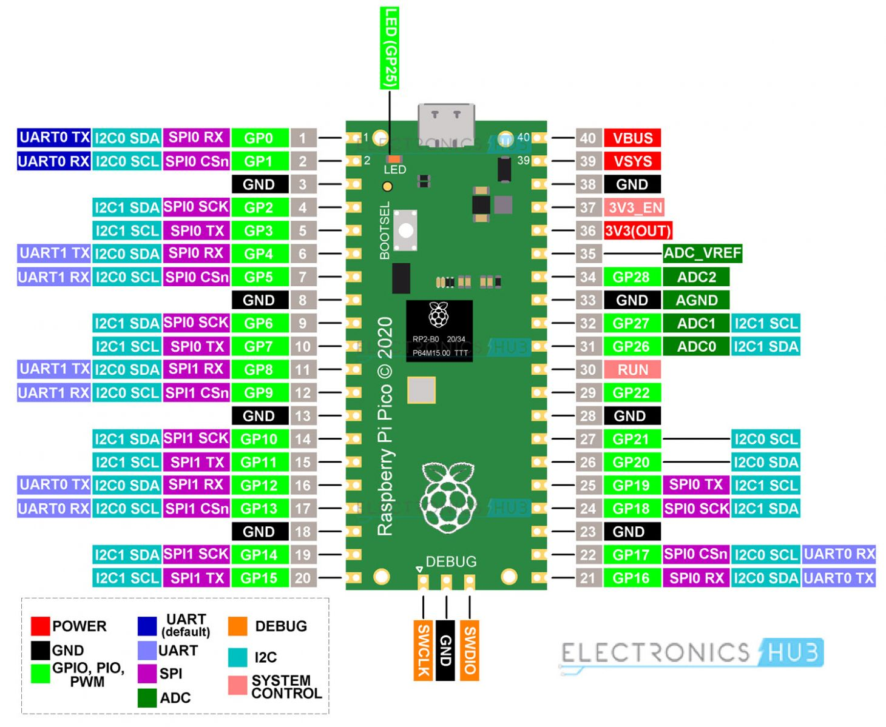

# Pico

Raspberry Pi Pico

Author

Benedict Thekkel

## Pico Boards

Let me pull the official specs to get the Pico 2 family details right.Here’s the current official lineup. There are two generations — Pico 1 (RP2040) and Pico 2 (RP2350) — and each generation comes in four variants that differ by wireless connectivity (the “W” suffix adds Wi-Fi and Bluetooth) and whether headers are presoldered.

**All 8 variants**

| Board | Chip | Wireless | Headers | SWD connector |
|----|----|----|----|----|
| Pico | RP2040 | No | No | Castellated pads, bottom edge |
| Pico H | RP2040 | No | Yes | JST-style, bottom edge |
| Pico W | RP2040 | Wi-Fi + BT | No | Through-hole pads, central |
| Pico WH | RP2040 | Wi-Fi + BT | Yes | JST-style, central |
| Pico 2 | RP2350 | No | No | Castellated pads, bottom edge |
| Pico 2 with headers | RP2350 | No | Yes | JST-style, bottom edge |
| Pico 2 W | RP2350 | Wi-Fi + BT | No | Through-hole pads, central |
| Pico 2 W with headers | RP2350 | Wi-Fi + BT | Yes | JST-style, central |

Within each generation the variants are hardware-identical apart from wireless and headers, so the real spec differences are between the two chips:

**Core specs by generation**

| Spec | Pico 1 (RP2040) | Pico 2 (RP2350) |
|----|----|----|
| CPU | Dual-core Arm Cortex-M0+ | Dual-core Arm Cortex-M33 or dual-core Hazard3 RISC-V (switchable) |
| Max clock | 133 MHz | 150 MHz |
| SRAM | 264 kB | 520 kB |
| On-board flash | 2 MB | 4 MB |
| GPIO | 26 multi-function pins | 26 multi-function pins |
| PIO state machines | 8 | 12 |
| ADC | 3× 12-bit | 3× 12-bit |
| Interfaces | 2× SPI, 2× I2C, 2× UART, 16 PWM | 2× SPI, 2× I2C, 2× UART, 16 PWM |
| USB | USB 1.1 (device + host) | USB 1.1 (device + host) |

**Wireless (W variants only):** All W boards use the Infineon CYW43439 chip providing single-band 2.4 GHz Wi-Fi 802.11n (with WPA3) and Bluetooth 5.2 (BLE + Classic). The Pico 2 is also hardware and software compatible with Pico 1, and adds a security/crypto feature set on the RP2350.

One thing worth noting if you’re trying to ID a board in hand: the wireless variants moved the debug connector to the centre (under the chip) rather than the bottom edge, and the “2” boards report as `RP2350` over USB mass storage rather than `RPI-RP2`.

## Pinout

Back to top
